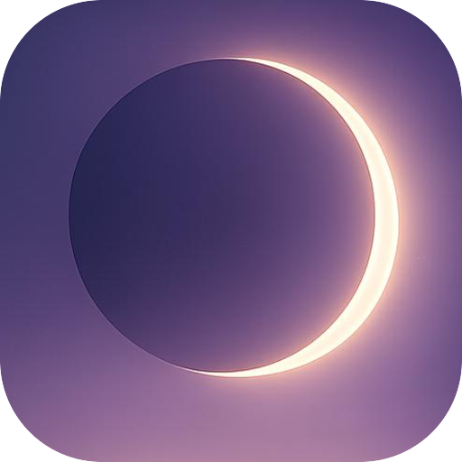

<div align="center">



# Novafin

**A Jellyfin client for Android, built for video.**

Movies, shows and anime on phones and tablets: direct play first, transcoding when needed,
downloads that sync back when you're online again, and audio and subtitle choices remembered per show.

[](https://kotlinlang.org)
[](https://developer.android.com/compose)
[](https://developer.android.com/media/media3)
[](https://jellyfin.org)
[](https://www.android.com)

</div>

---

## Features

- ▶️ **Smart Playback** — device profile built from the phone's decoders; direct play, then remux, then HLS transcode, with an automatic transcode retry if a file won't decode
- 🎚 **Quality Presets** — Original / High / Medium / Low / Data saver, separate for Wi-Fi and mobile data, with "smart original" when the source is already small enough and auto step-down on rebuffering
- 🗣 **Track Memory** — audio and subtitle picks remembered per show or movie, matched by language, kind (full vs Signs & Songs) and title on every new episode
- ⬇️ **Downloads** — original files or transcoded HLS at a chosen preset, season downloads, keep-next-N episodes per show, storage limit, auto-delete watched, Wi-Fi only, SD card support
- 🔄 **Offline Sync** — watch progress made offline is queued and merged back on reconnect; the newest device wins
- 🌐 **Multiple Addresses** — LAN, Tailscale and public addresses for one server, raced in the background so the best one is always used, switching mid-stream without interruption
- 📺 **Chromecast** — hands playback to the TV from the current position, keeps reporting progress, and keeps playing with the phone off
- 🖼 **Picture-in-Picture** — keep watching while browsing the app, or let audio continue in the background
- ⏭ **Skip Intro & Autoplay** — skip intro and recap segments, autoplay the next episode
- 👆 **Player Gestures** — double-tap seek, brightness and volume swipes, scrubbing with trickplay thumbnails and chapter ticks, pinch to zoom, rotate lock
- 💬 **Subtitle Styling** — size, colour, background and position; PGS and ASS supported in direct play
- 📱 **Phone & Tablet Layouts** — bottom bar on phones, navigation rail, hero and two-pane details on tablets
- 🔑 **Quick Connect** — sign in from another device without typing a password, or approve another device's code from Settings
- 🧭 **Discovery** — genre and cast pages, "More like this", "Because you watched" rows, a top-rated-unwatched row, "Surprise me", and a suggestion when a movie ends
- 🔎 **Filters & Search** — combinable filters (watched, favourites, genres, decades, rating, resolution) with removable chips; search by movies, shows, episodes and people, with recent searches
- 🏠 **Home Layout** — choose which Home rows show and their order
- 🧩 **Widgets** — "Continue watching" and "Next up", compact and wide, drawn from a local snapshot so they work offline
- 👥 **Accounts & Devices** — several saved servers or users, plus a list of your other devices with "Continue here"
- 🍿 **Watch Together** — SyncPlay groups through the server, with shared play, pause and seek
- 📋 **Playlists & Favourites** — video playlists (add to the start or the end, reorder, play all), favourites across libraries, and sharing a title
- ⚙️ **Settings** — grouped into categories with their current values, two panes on tablets
- 🌌 **Aurora Theme** — dark theme with an animated, GPU-rendered aurora sky

## Tech Stack

| Layer | Choice |
|---|---|
| Language & UI | Kotlin, Jetpack Compose, Material 3 |
| Navigation | Navigation 3 |
| Playback | Media3 ExoPlayer + HLS, `MediaSessionService` |
| Casting | Media3 `CastPlayer` |
| Networking | OkHttp + `org.json` (no Jellyfin SDK) |
| Images | Coil 3 |
| Storage | SharedPreferences, JSON files |

## Quick Start

Needs **JDK 17+** and the Android SDK (compileSdk 37). Android 9 or newer on the device.

```bash
./gradlew assembleDebug      # build the debug APK
./gradlew installDebug       # install on a connected device
```

Open the app, enter your server address (Quick Connect or username/password), and you're in. More
addresses for the same server can be added later under Settings → Account & servers, and other
servers or users with "Add account".

## Development

```bash
./gradlew test               # unit tests for the pure logic (tracks, sync merge, filters, accounts, SyncPlay, parsing)
./gradlew assembleRelease    # R8-minified release build
```

## Project Structure

```
app/src/main/java/xyz/yuuki/novafin/
├── App.kt              # Application: prefs, API, downloads, network monitor, image loader
├── Api.kt              # Jellyfin calls, address racing
├── Models.kt           # Items, media sources, streams, segments
├── DeviceProfile.kt    # Device profile from MediaCodecList, quality presets
├── Playback.kt         # PlaybackService: ExoPlayer, CastPlayer, progress reporting
├── Tracks.kt           # Audio / subtitle picking
├── LibraryFilter.kt    # Combinable library filters and their active chips
├── Discovery.kt        # LAN server discovery, readable connection errors
├── SyncPlay.kt         # Watch together: group state machine over the session WebSocket
├── Widget.kt           # Home screen widgets from a local snapshot
├── Downloads.kt        # Download service, offline index, reconnect sync
├── Prefs.kt            # Settings, saved accounts, track memory
├── MainActivity.kt     # Shell: bottom bar / navigation rail
├── PlayerActivity.kt   # Fullscreen player, PiP
└── ui/                 # Compose screens, theme and the aurora sky
```

See **[PLAN.md](PLAN.md)** for the full design: API surface, playback decision, quality presets,
downloads, offline sync and casting, and **[IMPROVEMENT_PLAN.md](IMPROVEMENT_PLAN.md)** for the
product plan: what Jellyfin 10.11 can and can't do (sessions, SyncPlay, widgets, ordering) and the
backlog.
